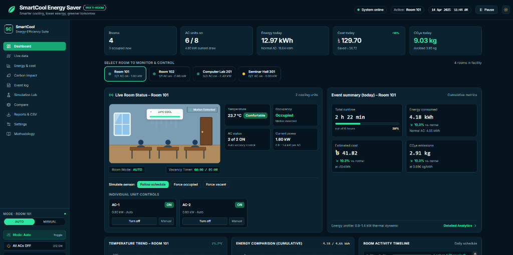

# SmartCool Energy Saver ❄️⚡

> **Intelligent, Occupancy-Aware Multi-Room Cooling Simulation & Energy Optimization Suite**  
> *Smarter cooling, lower energy, greener tomorrow.*



---

## 🌟 Overview

**SmartCool** is an advanced energy-efficiency simulation and demonstration platform designed to optimize air conditioning usage across educational institutions, computer labs, seminar halls, and commercial spaces. 

In traditional facilities, AC units are frequently left running continuously across empty lecture breaks, cancelled sessions, and schedule gaps. SmartCool models continuous occupancy detection through simulated PIR motion sensors, dynamic thermal physics, and an auditable vacancy confirmation grace period. Compressors are automatically powered down or set back when spaces remain empty, eliminating wasted power while maintaining occupant comfort.

---

## ✨ Key Features

### 🏢 Multi-Room Real-Time Simulation Engine
- **Discrete 1-Minute Time Stepping**: Simulates facility operations across a standard workday (9:00 AM – 3:00 PM / $T_0=540$ to $T_E=900$).
- **Live Synchronized Clock**: Ticking simulation clock with pause, resume, and variable simulation speeds (200 ms to 4000 ms per simulated minute).
- **Realistic Thermal Thermodynamics**: 
  - Room temperature dynamically cools towards $(T_{\text{set}} - 0.6^\circ\text{C})$ when AC units are active.
  - Heat dissipates and warms towards $31^\circ\text{C}$ (occupied) or $30.5^\circ\text{C}$ (vacant) when units are powered off.
  - Individual compressor power draws vary dynamically between $0.8\text{ kW}$ and $1.4\text{ kW}$ according to thermal load and temperature differentials.
- **Simultaneous Conventional Baseline Tracking**: Computes an "always-on" baseline side-by-side to provide continuous, real-time comparisons of energy savings and financial returns.

### 🎨 Interactive Live Room Graphic & Controls
- **Dynamic Animated Room Illustration**: Interactive SVG displaying classroom window with sunlight sheen, wooden door, desks, dynamic student occupants (rendered when occupied), and **animated cool air airflow vents** blowing downwards when cooling is active.
- **Multi-Room Quick Switching**: Select between **Room 101**, **Room 102**, **Computer Lab 201**, and **Seminar Hall 301** with live status dots, active unit count, and real-time kW draw.
- **Granular Controls & Override Modes**:
  - Individual AC unit toggles (`Turn ON/OFF` and `Set Auto/Manual`).
  - Room-level quick controls (`AUTO / MANUAL` segmented control, `Mode Toggle`, `All ACs ON/OFF`, and `Reset Room`).
  - **Sensor Simulation Controls**: Interactively test PIR triggers with `Follow schedule`, `Force occupied`, or `Force vacant`.

### 📊 Comprehensive Visualization Suite
- **SVG Temperature Trend Chart**: Dual-line graph displaying SmartCool temperature curve vs. Normal AC baseline curve vs. dashed comfort setpoint line ($24^\circ\text{C}$).
- **Cumulative Energy Comparison Chart**: Time-series plot illustrating the widening kWh savings margin over the course of the day.
- **Room Activity Timeline**: Visual blocks for scheduled lectures, breaks, and long breaks with an active highlight ring indicating the current period.
- **Side-by-Side Comparison Bars**: Normalized visual bars comparing electricity consumption (kWh) and utility costs (৳).
- **High-Impact Savings Box**: Immediate summary of kWh saved, percentage energy reduction, BDT ৳ saved, and avoided $\text{CO}_2\text{e}$.

---

## 🧭 Multi-Page Platform Architecture

| Page | Route | Description |
| :--- | :--- | :--- |
| **Dashboard** | `/` | Central command center with multi-room KPIs, live room graphic, unit controls, trend charts, timeline, and savings highlight card. |
| **Live Data** | `/monitoring` | Facility-wide tabular matrix showing every room and AC unit with live power draw, room temperature, vacancy timer, and direct switches. |
| **Energy & Cost** | `/analytics` | Detailed room-by-room financial and electricity consumption ledger with relative comparative progress bars. |
| **Carbon Impact** | `/carbon` | Greenhouse gas accounting dashboard tracking avoided $\text{CO}_2\text{e}$ emissions based on configurable grid emission factors. |
| **Event Log** | `/events` | Auditable chronological stream of motion detections, vacancy countdown triggers, and compressor state transitions with room and category filters. |
| **Simulation Lab** | `/lab` | Reproducible scenario runner supporting pseudo-random seed configuration, custom durations, and backend API execution. |
| **Compare** | `/compare` | Objective apple-to-apple evaluation comparing conventional baseline controls directly against SmartCool. |
| **Reports & CSV** | `/reports` | One-click client-side export generating standardized CSV downloads for time-series minute traces, facility financial summaries, and event logs. |
| **Settings** | `/settings` | Real-time configuration panel for electricity tariffs, grid emission factors, vacancy timeouts, setpoints, simulation clock speed, and facility room management (add/remove spaces). |
| **Methodology** | `/methodology` | Scientific disclosure detailing the mathematical power functions, thermodynamic equations, and system assumptions. |

---

## 🛠️ Tech Stack

- **Frontend**: [Next.js 14](https://nextjs.org/) (App Router), [React 18](https://react.dev/), [TypeScript](https://www.typescriptlang.org/), [Tailwind CSS](https://tailwindcss.com/), [Lucide React](https://lucide.dev/)
- **Theme**: Dual-mode (Deep energy-tech Dark mode default with instant Light mode toggle)
- **Backend API**: [FastAPI](https://fastapi.tiangolo.com/) (Python 3), [Uvicorn](https://www.uvicorn.org/), [SQLAlchemy](https://www.sqlalchemy.org/), [SQLite](https://sqlite.org/)

---

## 📁 Repository Structure

```
SmartCool/
├── backend/
│   ├── app/
│   │   ├── api/
│   │   │   └── routes.py         # FastAPI endpoints (/simulations, /rooms/defaults, /settings/defaults)
│   │   ├── db/
│   │   │   └── models.py         # SQLAlchemy ORM models (SimulationRun, ReadingRecord, EventRecord)
│   │   ├── energy/
│   │   │   └── calculator.py     # Deterministic energy & strategy comparison engine
│   │   ├── simulator/
│   │   │   ├── engine.py         # Physical simulation engine & schedule generator
│   │   │   └── states.py         # Control state definitions (OCCUPIED, VACANCY_PENDING, etc.)
│   │   └── tests/
│   │       └── test_simulation.py# Backend automated validation tests
│   ├── main.py                   # Backend entrypoint (port 8000)
│   └── requirements.txt          # Python dependencies
├── frontend/
│   ├── public/
│   │   └── dashboard.png         # UI screenshot asset
│   ├── src/
│   │   ├── app/
│   │   │   ├── analytics/        # Energy & cost breakdown page
│   │   │   ├── carbon/           # Carbon footprint & emissions page
│   │   │   ├── compare/          # Baseline comparison page
│   │   │   ├── events/           # Filterable event log page
│   │   │   ├── lab/              # Simulation laboratory page
│   │   │   ├── methodology/      # Scientific methodology & equations page
│   │   │   ├── monitoring/       # Live multi-room data table page
│   │   │   ├── reports/          # CSV export generation page
│   │   │   ├── settings/         # Parameters & room management page
│   │   │   ├── globals.css       # Design tokens, CSS variables, and airflow animations
│   │   │   ├── layout.tsx        # Root layout with SimulationProvider, Header & Sidebar
│   │   │   └── page.tsx          # Main multi-room dashboard
│   │   ├── components/
│   │   │   ├── Charts.tsx        # Interactive SVG charts (Trend, Cumulative, Bars, Timeline)
│   │   │   ├── Header.tsx        # Global top navigation, clock, play/pause, and theme switch
│   │   │   ├── RoomIllustration.tsx # Classroom SVG illustration with animated cooling vents
│   │   │   └── Sidebar.tsx       # Navigation links and active room quick controls
│   │   ├── context/
│   │   │   └── SimulationContext.tsx # Central simulation state provider & ticker
│   │   └── lib/
│   │       └── sim-adapter.ts    # Frontend data adapters and types
│   ├── package.json
│   └── tailwind.config.js
├── screenshots/
│   └── dashboard.png             # Readme hero image
├── .env.example
└── README.md
```

---

## 🚀 Getting Started

### Prerequisites
- **Node.js** (v18.x or v20.x+)
- **Python** (v3.10+ or v3.12+)

---

### 1. Setting up the Backend

1. Navigate to the `backend` directory:
   ```bash
   cd backend
   ```
2. Install dependencies:
   ```bash
   pip install -r requirements.txt
   ```
3. Run verification tests:
   ```bash
   python app/tests/test_simulation.py
   ```
4. Start the FastAPI server:
   ```bash
   python main.py
   ```
   *The backend will be running at `http://localhost:8000` (API documentation available at `http://localhost:8000/docs`).*

---

### 2. Setting up the Frontend

1. Open a new terminal and navigate to the `frontend` directory:
   ```bash
   cd frontend
   ```
2. Install Node dependencies:
   ```bash
   npm install
   ```
3. Start the Next.js development server:
   ```bash
   npm run dev
   ```
4. Open your browser and navigate to:
   ```
   http://localhost:3000
   ```

---

## ⚙️ Configurable Simulation Parameters

All parameters are customizable directly from the **Settings** view in the UI or via backend API payloads:

| Parameter | Default | Unit | Description |
| :--- | :--- | :--- | :--- |
| **Electricity Tariff** | `10.0` | BDT (৳) / kWh | Commercial/institutional electricity rate. |
| **Grid Emission Factor** | `0.696` | kg $\text{CO}_2\text{e}$ / kWh | Regional electricity grid carbon intensity coefficient. |
| **Vacancy Timeout** | `5` | Minutes | Elapsed time of zero motion before automatic compressor shutdown. |
| **Comfort Setpoint** | `24.0` | °C | Target room thermostat cooling temperature. |
| **Full-Load AC Rating** | `2.5` | kW | Rated power consumption of individual AC compressor under heavy thermal load. |
| **Simulation Speed** | `1500` | ms / sim-min | Real-world milliseconds per simulated minute. |

---

## 🔬 Mathematical Formulation

### Compressor Power Load Function
$$P(t) = \text{clamp}\left(0.8 + (T(t) - T_{\text{set}}) \times 0.1 + 0.05 \sin(\dots),\, 0.8,\, 1.4\right)\text{ kW}$$

### Temperature Dynamics
- **Cooling Cycle ($k$ units ON out of $N$ total)**:
  $$T(t+1) = T(t) + (T_{\text{target}} - T(t)) \times 0.05 \times \frac{k}{N} + 0.04 \sin\left(\frac{t}{3}\right)$$
- **Natural Thermal Dissipation (Units OFF)**:
  $$T(t+1) = T(t) + (T_{\text{ambient}} - T(t)) \times 0.02$$
  *(where $T_{\text{ambient}} = 31^\circ\text{C}$ if occupied, $30.5^\circ\text{C}$ if vacant)*

### Energy Integration & Savings
$$E_{\text{SmartCool}} = \sum_{t=T_0}^{T_E} \left( \sum_{i=1}^{k} \frac{P_i(t)}{60} \right) \text{ kWh}$$
$$\text{Net Saved (kWh)} = E_{\text{Normal}} - E_{\text{SmartCool}}$$
$$\text{Cost Saved (৳)} = \text{Net Saved} \times \text{Tariff}$$
$$\text{Avoided }\text{CO}_2\text{e (kg)} = \text{Net Saved} \times \text{Emission Factor}$$

---

## 📄 License & Transparency Notice

This project is an engineering prototype and research simulation platform. All telemetry data, temperatures, and occupancy logs are synthetically generated by deterministic physical models to demonstrate automated energy efficiency control logic.
